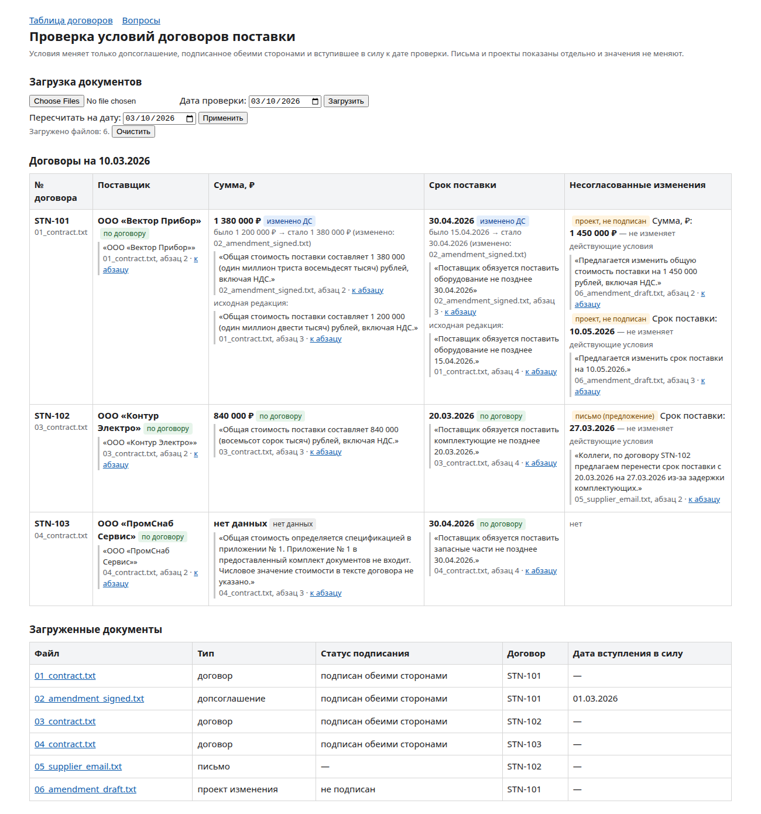

# Проверка условий договоров поставки — прототип

Локальное веб-приложение для специалиста по закупкам: загружает TXT-договоры и связанные документы, показывает
сумму и срок поставки на дату проверки, и к каждому значению даёт имя файла, точную цитату и переход к абзацу.
Значения меняет только подписанное обеими сторонами и вступившее в силу допсоглашение; письма и проекты показываются
отдельно как несогласованные предложения.

## Установка и запуск

Требуется Python 3.11+ (тесты прогнаны на 3.11 и 3.14). Платные сервисы, ключи и сеть для работы не нужны.

```bash
git clone <URL репозитория> && cd stn-contract-checker
python -m venv .venv
source .venv/bin/activate            # Windows: .venv\Scripts\activate
pip install -r requirements.txt      # или точные проверенные версии: pip install -r requirements-lock.txt
python -m uvicorn app.main:app       # открыть http://127.0.0.1:8000
```

Проверки:

```bash
python -m pytest -q                  # 46 тестов: правила, статусы, оракул на documents/, HTTP-сценарий, gate
python scripts/gate.py               # anti-hardcode: в app/ нет номеров, сумм, дат, компаний, имён файлов комплекта
```

`make install | run | test | gate | check` — то же через Makefile (Linux/macOS). В GitHub тесты и gate запускаются
автоматически (`.github/workflows/ci.yml`). Предупреждение `StarletteDeprecationWarning` при тестах исходит из
библиотеки TestClient и на результат не влияет.

Параметры (переменные окружения, необязательно): `STN_CHECK_DATE` (по умолчанию `2026-03-10`),
`STN_DEADLINE_BEFORE` (пресет вопроса 4, `2026-04-01`), `STN_LLM=ollama` + `STN_OLLAMA_MODEL` — см. «Ограничения».



## Структура репозитория

| Путь | Что внутри |
|---|---|
| `app/` | Приложение: `ingest` → `classify` → `link` → `extract/` → `resolve` → `verify`; `queries` (4 вопроса), `main` (веб) |
| `app/extract/registry.py` | Реестр извлекателей: новое поле = функция + `@register` + тест |
| `tests/unit`, `tests/acceptance` | Синтетические документы и ловушки; оракул по `documents/`, HTTP-сценарий, «новый договор», мутации |
| `scripts/gate.py` | Проверка отсутствия данных комплекта в коде приложения |
| `documents/` | Учебный комплект (6 TXT) |
| `prompts/exec_stn_dev.md` | EXEC-промпт, по которому ИИ-агент вёл разработку (см. «Отчёт о вайбкодинге») |
| `docs/` | План S0, журнал времени, решения, журнал ошибок ИИ, история версий промпта, скриншоты |

## Сценарий использования

1. Главная страница → «Выберите файлы» → выделить все TXT из `documents/` → «Загрузить». Дата проверки — 10.03.2026.
2. Таблица по договорам: № | поставщик | сумма | срок | несогласованные изменения. У каждого значения — статус
   (`по договору`, `изменено ДС`, `нет данных`, `требует проверки`), цитата, файл, номер абзаца и ссылка «к абзацу»
   (открывает исходный текст с подсвеченной цитатой). Для изменённых значений показано «было → стало» и обе цитаты.
3. Страница «Вопросы»: кнопки для каждого загруженного договора и формы с параметрами.
   - Срок STN-101 на 10.03.2026 → 30.04.2026, изменено ДС № 1 (`02_amendment_signed.txt`); проект ДС № 2 (10.05.2026) отмечен как не подписанный.
   - Сумма STN-102 → 840 000 ₽ (аванс 252 000 не путается с суммой).
   - Сумма STN-103 → «нет данных»: цитата п. 2.1 объясняет, что стоимость в приложении, которого нет; лимит 600 000 — не стоимость.
   - Поставка раньше 01.04.2026 → STN-102 (20.03.2026); есть несогласованное изменение срока — письмо поставщика (27.03.2026).
4. Повторная загрузка файла с тем же именем заменяет его; «Очистить» сбрасывает набор. Дату проверки можно поменять — всё пересчитается.

## Известные ограничения

- Формат: TXT того же общего вида (заголовок, строки «Дата:», «Статус:», нумерованные пункты, абзацы через пустую строку).
  UTF-8; cp1251 читается с пометкой. PDF/DOCX/OCR — вне объёма.
- Правила на ключевых словах: формулировки, сильно отличающиеся от «общая/итоговая стоимость (цена договора) … рублей»
  и «поставить … не позднее ДАТА», дадут «нет данных» — не выдуманное значение.
- Статус подписания определяется по строке «Статус:», а не по реквизитам и подписям.
- Абзац = блок через пустую строку; ссылка ведёт на блок, цитата подсвечена внутри.
- Хранилище в памяти, один пользователь, без авторизации; после перезапуска файлы нужно загрузить снова.
- LLM-слой — необязательная заглушка: при `STN_LLM=ollama` и запущенной локальной Ollama модель ищет пункт, который
  не нашли правила; ответ принимается, только если цитата буквально есть в тексте, и всегда помечается «требует проверки».
  Без Ollama приложение работает полностью. Реальный вызов модели в рамках задания не проверялся (только тестами с подменой).
- Ставка неустойки не извлекается — оставлено для изменения на встрече (реестр извлекателей `app/extract/registry.py`).

---

## Записка

**Пользователь.** Специалист по закупкам, сверяющий действующие сумму и срок поставки по пакету документов
(договор + допсоглашения + переписка), которому важно не пропустить согласованное изменение и не принять за него
предложение. Ему нужна не «умная» выдача, а проверяемая: значение → цитата → абзац.

**Пять вопросов клиенту перед развитием.**
1. Какие типовые формы договоров и ДС используются и сколько их вариантов (свои шаблоны или формы контрагентов)?
2. Откуда достоверно берётся статус подписания и дата вступления в силу — из текста, из СЭД (ЭП, маршрут согласования) или из учётной системы?
3. Как разрешать коллизии: два ДС на одну дату, ДС, меняющее приложение/спецификацию, частичные поставки по этапам?
4. Нужно ли учитывать приложения и спецификации (STN-103), и в каком виде они поступают?
5. Что дальше происходит с результатом: отчёт, выгрузка в 1С/ERP, задача на согласование, напоминание о сроках?

**Допущения.** TXT общего формата; статус — по строке «Статус:»; ДС действует при «подписано обеими сторонами»,
дате вступления ≤ даты проверки и дате подписания ≤ даты проверки; ДС без даты вступления — «требует проверки»;
сумма берётся как в тексте (с НДС), без пересчёта; «раньше 1 апреля» — строго меньше даты; если в одном документе
два разных значения поля — «требует проверки»; связь по номеру договора, расхождение поставщика — «требует проверки».

**Метрики.**
1. Точность полей с подтверждённой цитатой (field-level precision) на размеченной выборке: доля значений, совпавших с
   эталоном, среди выведенных как `по договору / изменено ДС`. Цель — близко к 100%: ошибка хуже «нет данных».
2. Доля полей «требует проверки / нет данных» и время сверки одного договора закупщиком (до/после) — показывает,
   сколько ручной работы реально снято.

**Архитектура.**

```
TXT ─► A1 Ingest ─► A2 Classify ─► A3 Link ─► A4 Extract (registry) ─► A5 Resolve(check_date) ─► A6 Verify ─► UI / API
      абзацы,      тип, статус,   договор ↔   сумма, срок; новые       применить EFFECTIVE ДС;   цитата==срез,
      смещения     даты, стороны  документы   редакции «…»; предложения прочее → предложения     значение⇔основание
```

Код: `app/ingest.py`, `classify.py`, `link.py`, `extract/`, `resolve.py`, `verify.py`, `queries.py`, `main.py`.

**Три ключевых решения и компромиссы.**
1. *Правила вместо LLM в основном сценарии.* Плюс: детерминированно, бесплатно, легко тестировать и объяснять,
   не выдумывает. Минус: хрупко к формулировкам вне шаблонов — компенсируется «нет данных»/«требует проверки» и
   опциональным LLM-слоем с жёстким гейтом цитаты.
2. *Цитата = срез исходного текста по смещениям + инвариант V1.* Плюс: ссылка и подсветка всегда точны, подмена
   ловится. Минус: цитата — целое предложение, иногда длиннее, чем нужно; при разных переводах строк требуется нормализация.
3. *Статус документа решает всё, дата — параметр.* Плюс: правило задания реализовано явно (`resolve._status_of`),
   результат пересчитывается на любую дату, порядок загрузки и имена файлов не влияют (есть тест). Минус: без
   надёжного источника статуса (СЭД, ЭП) доверяем строке «Статус:» в тексте.

**100 000 документов и права доступа.** Пакетная обработка через очередь с сохранением результата и версий
(PostgreSQL для карточек/оснований, полнотекстовый индекс — OpenSearch/PG FTS для поиска и связывания); связывание по
реестру договоров из учётной системы, а не только по номеру в тексте; статус подписания — из СЭД/ЭП; ACL на уровне
документа применяется до выдачи и при построении карточки (нельзя показать сумму из ДС, к которому нет доступа — показывать
«есть документ без доступа»); аудит просмотров и решений; мониторинг доли «требует проверки» по типам документов;
гибрид правила + LLM для нетиповых форм с тем же гейтом цитат и выборочной ручной разметкой для контроля точности.

**Три следующих улучшения (по приоритету).**
1. Набор из 30–50 реальных обезличенных документов клиента с эталонной разметкой и отчёт точности по полям — без него
   нельзя расширять правила безопасно.
2. Новые поля через реестр: ставка неустойки, условия оплаты, приложения/спецификации (закрывает STN-103).
3. Импорт статусов из СЭД и экспорт результата (CSV/1С), уведомления о приближающихся сроках поставки.

---

## Отчёт о вайбкодинге

**Инструмент.** Perplexity Computer (агент с терминалом и файловой системой) по EXEC-промпту
`prompts/exec_stn_dev.md` (роли архитектор/исполнитель/тестировщик/проверяющий/документалист, стадии с гейтами).

**Характерные запросы к ИИ.**
1. «Выполни S0 PLAN и остановись на CHECKPOINT» — EXEC-промпт целиком: правила домена, запрет хардкода, тесты-оракулы, тайм-бокс.
2. «Напиши извлекатель суммы: кандидат — пункт про общую/итоговую стоимость, исключи аванс, лимит, бюджет; при
   „не указано / в приложении“ верни NO_DATA с цитатой пункта, объясняющего отсутствие».
3. «Сымитируй правки интервьюера: сдвинь дату вступления ДС, подпиши ДС одной стороной, добавь сумму в STN-103,
   убери слово „Общая“ — и покажи, что меняется в результате».

**Ошибки ИИ и как найдены.**
- В комментариях к коду ИИ использовал примеры прямо из учебного комплекта (название поставщика, суммы).
  Логика от этого не зависела, но это нарушение правила «не вшивать данные». Поймал gate (`scripts/gate.py`, GATE: FAIL) —
  примеры заменены нейтральными.
- Правило суммы требовало слов «общая/итоговая стоимость» и пропускало формулировку «Цена договора составляет …».
  Найдено враждебной проверкой (S8) — правило расширено, добавлены тесты на «цену договора» и на то, что процент
  неустойки от «стоимости договора» не становится суммой.

Фактические затраты и оставшиеся задачи — `docs/WORKLOG.md`.
